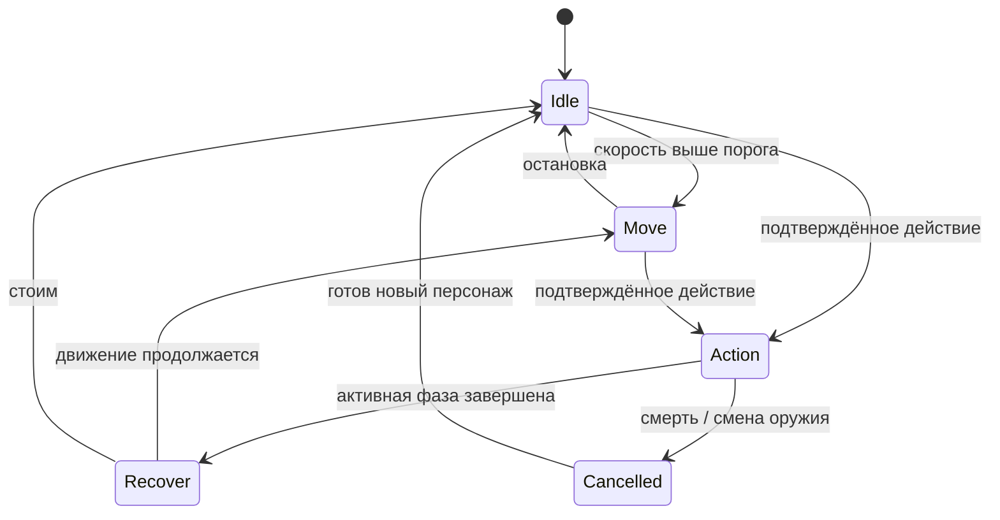

# Паттерны реализации по визуальному обзору

Основание: [50 карточек наблюдений](/Users/andrej/Documents/ChatGPT/skills/roblox-research/builder-top50/2026-11-06/visual/index.md). Это выводы о проектировании собственных систем по видимому поведению, не реконструкция закрытых исходников. Публичные записи просмотрены фрагментами; точные параметры, внутренние API и полный набор экранов неизвестны.

Поиск: маршруты/карта; HUD/контекст/модальные окна; инвентарь/предпросмотр; цикл раунда; питомцы/эволюция; переноска/слои анимации; волны/размещение; транспорт/физика; производство; раскрытие случайной награды.

## 1. Карта строится вокруг действия

| Наблюдаемый тип | Источники | Решение для своей игры | Проверка |
|---|---|---|---|
| База → рискованный маршрут → возврат | №1,13: зоны между стенами, слоты базы, speed-порог | Конфиг Zone с маршрутами входа/выхода, точками предметов и проверкой доступа; BaseSlot хранит ссылку на экземпляр коллекции | Полный/пустой слот, два игрока у предмета, минимальная и максимальная скорость |
| Город с независимыми ролевыми действиями | №2,32,36: дороги, дома, транспорт, контекстные UI | Районы/дома/транспорт получают стабильные ID; роль не меняет владельца всего мира | Выход владельца, смена дома, спавн транспорта на занятом месте |
| Петли погони и укрытия | №21,34: проёмы, паллеты, углы, высоты | Граф проходов проверять для обеих ролей, препятствие имеет серверное состояние | Убийца и выживший обходят маршрут без тупиков и недопустимых проходов |
| Вертикальная модульная трасса | №25,44: ярусы/разрывы/движущиеся опасности | Сегмент задаёт вход/выход, bounds, сложность и диапазон скорости; seed хранится с раундом | Проходимость реальным персонажем с игровой камерой; опасность заметна до прыжка |
| Маршрут волн с местами размещения | №12,28,39: враги на пути, союзники рядом | Waypoint-маршрут и поверхности размещения разделены; границы построек проверяет сервер | Установка не перекрывает путь, враг доходит до цели после поворотов |

Это разные топологии: не переносить прямой коридор сбора яиц на социальный город автоматически. Декор вводить после проверки маршрута. У арены важнее линии обзора/дистанции, у коллекции — читаемый возврат и ориентиры.

## 2. UI имеет несколько независимых слоёв

В №1/13 видно постоянное Shop/Index и мирные подписи яиц; №28/39 — выбранный юнит и его радиус; №36 — телефон поверх продолжающегося мира. Из этого следует полезное разделение собственной архитектуры:

- HUD: ресурсы, время, здоровье, активные слоты; живёт между краткими действиями.
- Контекст: Grab/Sell/Use/Trunk/Talk, выбранная станция или цель. Скрывается, когда действие недопустимо.
- Экран системы: инвентарь, магазин, телефон, редактор внешности. Имеет явные open/back/close и выбранный объект.
- Краткий результат: награда, улов, победа. Не меняет владельца предмета и не начисляет деньги сам.
- Системный UI Roblox/вставки автора записи: не часть собственного ScreenGui.

Для каждого экрана определи состояние `closed/loading/ready/pending/error`, источник данных и поведение при исчезновении объекта. После продажи выбранного предмета очисти выделение; после закрытия окна верни фокус/управление. Проверяй пустую коллекцию, длинные названия, полную вместимость и повторное нажатие.

По источникам №7 (клавиатура), №9/28/34 (сенсорный HUD), №36/48 (геймпад) полезно проверять разные способы ввода. Внутри логики используй действие `Attack/Interact/Back`, а текст клавиши/кнопки выбирай для устройства. Не копируй мобильные круги на десктоп без необходимости. На основе старой видеозаписи нельзя утверждать текущие размеры/тексты UI.

## 3. Коллекция, экземпляр и представление различаются

№19 показывает образ с составом, превью и Wear; №22 — active pets; №42 — отдельные Traits/Quirks. Собственная модель данных может быть такой:

```luau
-- Предлагаемый контракт данных, не код исследованных игр.
export type ItemDefinition = {
    typeId: string,
    modelKey: string,
    iconKey: string,
    category: string,
}
export type OwnedItem = {
    uid: string,
    typeId: string,
    ownerUserId: number,
    modifiers: {[string]: string},
}
```

Реестр определений общий; uid уникален у экземпляра. Экипировка — список uid, не копия всех моделей. Предпросмотр читает модель/иконку по ключу; факт владения устанавливает сервер. Для аватара образ — набор допустимых assetId и параметров, примерка отделена от сохранения/покупки. Для traits/quirks определи область действия и замену явно; предупреждение UI не заменяет серверную проверку.

При продаже/обмене/эволюции проверяй, что предмет не находится в несовместимой операции. Если есть торговля, её контракт и сохранение проектируются отдельно, а не выводятся из одной кнопки Trade.

## 4. Питомец и эволюция — разные задачи

В №5/22/43 видно спутников игрока; №37 показывает самого игрока как насекомое; №45 — изменённую форму/дополнение тела. Не объединять их в один follow-script.

**Спутник:** owner uid → вид/модель → размещение в группе → косметическое движение → отдельная подтверждённая способность. Проверки: исчезновение владельца, переполнение команды, десятки спутников в кадре, повторный вход.

**Управляемая форма:** выбранный тип → модель/риг → collider/contact offset → камера → locomotion → способности. Проверки: форма проходит двери/прыжки, ноги стоят на земле, камера не внутри меша, респавн восстанавливает форму и статистику.

Для каждой формы заранее задавай front/up, pivot, точки хвата/крепления, footprint, набор состояний и бюджет геометрии. Сложность оценивай измерением нагрузки; числа деталей из одного проекта не становятся общим лимитом скилла. Исследование №41 не показало охоту/движение ящериц: рецепт их рига остаётся предложением.

## 5. Анимация слоями и игровая фаза

№7 показывает viewmodel оружия от первого лица; №30 — оружие в третьем лице; №36 — переноску предмета/ребёнка одновременно с ходьбой; №37 — многоногую форму. В собственной системе разделяй:

- locomotion: idle/move/jump/fall и согласование скорости;
- верх тела/экипировка: hold/carry/aim;
- краткое действие: windup/active/recovery;
- принудительное состояние: stunned/dead/transform;
- камера/VFX: отдельное представление события.

Пример требуемых переходов (выбор под конкретную игру, не обязательная универсальная машина):



Carry-слой должен фиксировать руки относительно предмета, сохраняя шаги ног. После снятия предмета восстанови обычные дорожки. Обязательная практическая проверка — движение вперёд/назад, прыжок, атака по разрешённым правилам, снятие/смерть и респавн. Приоритеты/веса и способы воспроизведения проверь по актуальной документации Roblox под выбранный риг. 1 кадр/с недостаточен для измерения момента контакта, плавности и blend: для этого изучи сохранённый непрерывный клип или собери свой тест.

## 6. Раунд и общий дедлайн

№4/27: ожидание/матч/итог; №14: этаж → задачи → лифт → intermission; №26: подача → розыгрыш → очко; №46: переход поля → безопасность → результат. Общий переносимый принцип — одна серверная фаза и серверный дедлайн:

```luau
export type RoundView = {
    roundId: string,
    phase: string,
    endsAt: number?,
    revision: number,
}
```

Клиент вычисляет оставшееся время из синхронизированного серверного времени, но не решает, кто победил. Результат и выдачу награды привяжи к roundId + playerId; запоздалое действие старого раунда отвергай. При входе в середине матча клиент получает текущую фазу/снимок, а не ждёт следующего события начала. Проверяй выход ключевой роли, одновременную смерть, spectator и повторный запуск.

## 7. Волны, размещение и выбранный юнит

По №12/28/39 визуально различимы placement preview, круг дальности, upgrade/sell, новая волна и результат. Собственный поток:

1. Клиент предлагает typeId и transform; рисует допустимость только как предварительную подсказку.
2. Сервер проверяет поверхность, overlap, владельца, лимит, бюджет и фазу; создаёт uid и списывает цену ровно один раз.
3. SelectedUnit UI получает подтверждённые level/targetMode/stats. Радиус строится из того же конфига, что определяет допустимую цель.
4. Волна хранит список/счётчик активных врагов; закрывается после конца спавна и удаления последнего врага, а не только по таймеру.
5. Поражение/выход очищает текущую сессию и возвращает в допустимое lobby/replay.

Тестируй недоступную поверхность, проданный во время запроса юнит, недостаток денег, последний застрявший враг и смену скорости симуляции. На насыщенной сцене проверяй перекрытия имён/эффектов, как видно в №12.

## 8. Транспорт и физические взаимодействия

№2/35: посадка и поза, №33: захват/бросок предметов. Общий принцип — собственность на взаимодействие и жизненный цикл физического объекта. На сервере проверяй право захвата/посадки, допустимую дистанцию и текущее состояние; клиентская визуальная плавность не доказывает корректность владения.

Отдельно реализуй посадку, управление/трюк и выход. Настройки деталей/тюнинг меняют конфиг допустимым способом, не произвольную скорость из payload. Проверки: два игрока на одном месте, водитель вышел, переворот, восстановление и удаление объекта во время захвата.

## 9. Производственная цепочка

№40 показывает сырьё, конвейер, Peeling/Fryer, вместимость инструмента и время суток. Для своей игры опиши переходы `raw → prepared → cooked → served`, станцию с вместимостью и заказ с uid. Ручной игрок и автоматический помощник вызывают один проверяемый серверный переход. У предмета одна текущая локация: рука/сумка/лента/станция/заказ, чтобы перенос не создавал копию. Проверки: станция уже занята, выход носителя, повторная выдача клиенту, восстановление после ночной фазы.

## 10. Раскрытие результата отделено от получения

№3: spinner под указателем; №6/18: крупный результат улова; №31: массовые яйца; №42: reroll с предупреждением. Это способы представления, а не доказательство того, как вычислена награда.

Сервер определяет операцию/расход/результат; клиент получает operationId и результат, проигрывает раскрытие и показывает подтверждённую коллекцию. Skip/закрытие UI не повторяют выдачу. Для параллельных открытий порядок результатов и лимит эффектов задаются явно. Для платных/случайных предметов и торговли до реализации проверяй действующие правила Roblox; цифры/механики из записи не означают разрешение копировать их в свой продукт.

## Проверенные технические опоры

[AnimationPriority](https://create.roblox.com/docs/reference/engine/enums/AnimationPriority) описывает приоритет по суставам и смешивание одновременно играющих дорожек одного приоритета по весам. Поэтому для carry не следует записывать ненужные ключи ног: проверяй именно затрагиваемые суставы, веса и снятие слоя. [Input](https://create.roblox.com/docs/input) описывает действия с привязками под разные устройства; конкретные классы/свойства проверять перед реализацией. [Правила платных случайных предметов](https://create.roblox.com/docs/production/monetization/paid-random-items) — источник проверки доступности и раскрытия вероятностей; видео чужой игры эту проверку не заменяет. Документация проверена 2026-11-06.
