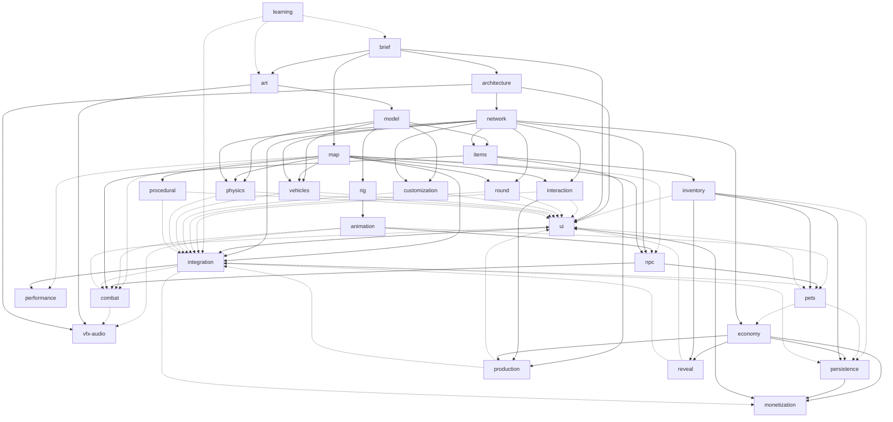

# Граф разработки

Сплошная стрелка — зависимость, пунктир — связанный контекст. Выбирай нужный подграф. `visual_examples` ссылается на позиции обзора и объясняет проектный паттерн; это не утверждение о внутреннем коде чужой игры.

| Узел | Результат | Проверка |
|---|---|---|
| brief | Цель, стиль, ограничения и критерии готовности | Сопоставить результат с явным запросом и решениями проекта |
| architecture | Размещение модулей, серверное состояние, клиентские представления | Проверить владение состоянием и зависимости модулей |
| map | Блокаут, маршруты, спавны, зоны и масштаб | Пройти маршруты в Play; проверить респавн и недоступные зоны |
| art | Палитра, формы, материалы и оригинальные ассеты | Сравнить с референсом с нескольких ракурсов |
| model | Модель с pivot, масштабом и разделёнными физикой/визуалом | Проверить bounding box, pivot, коллизии и переиспользование |
| rig | Скелет или Motor6D-иерархия с корректными осями | Повернуть суставы и проверить отсутствие отрыва деталей |
| animation | Клипы и переходы idle/move/action, согласованные с ригом | Наблюдать idle, движение, остановку, атаку и повторное появление |
| network | Контракты событий и серверные проверки | Подать неверные типы, дальность, частоту и недопустимое состояние |
| items | Реестр типов и уникальные экземпляры предметов | Проверить экипировку, снятие, повторную выдачу и неизвестный ID |
| inventory | Инвентарь, вместимость, экипировка и UI-модель | Проверить дубликаты запроса и полную вместимость |
| npc | Состояния NPC, цели, навигация и восстановление | Проверить потерю цели, препятствие, смерть и респавн |
| pets | Виды животных, следование, способности, ownership | Проверить несколько питомцев, исчезновение владельца и повторный вход |
| combat | Урон, хитбоксы, тайминги атак и телеграфы | Проверить попадания/промахи, дистанцию, кулдаун, смерть и награду |
| economy | Источники и траты ресурсов, цены, прогрессия | Проверить невозможность отрицательного баланса и двойной награды |
| persistence | Версия профиля, миграция и сериализация состояния | Тестовый профиль: выход/вход, ошибка записи, старый формат |
| ui | Согласованная визуальная система, адаптивный HUD/экраны, общие компоненты и состояния действий | Сравнить с выбранными референсами; проверить читаемость, иерархию, реальные данные/состояния, телефон/ПК и повторное открытие в Play |
| vfx-audio | События эффектов, звук и лимиты одновременности | Проверить своевременность, слышимость и очистку объектов |
| monetization | Точные продукты и идемпотентная серверная выдача | Проверить правила Roblox и повторный тестовый receipt |
| integration | Работающий игровой цикл с выбранными подсистемами | Плейтест от входа до результата и повторения цикла |
| performance | Профиль нагрузки и оптимизация узких мест | Измерить CPU/память/сеть на целевом устройстве до/после |
| learning | Записи правок, источников и проверенных улучшений | Проверить область, источник, отсутствие дублей и противоречий |
| interaction | Контекстные действия с объектами, права/дистанция и состояние запроса | Два игрока у объекта, исчезновение цели, повторное нажатие, неверная дальность |
| round | Фазы сессии, roundId, участники, дедлайны и результат | Вход в середине, выход ключевой роли, повтор итога и корректный restart |
| customization | Превью внешности, слои, цвета, наборы и подтверждение выбора | Снятый asset, несовместимый слой, отмена примерки и повторный вход |
| vehicles | Транспорт, места посадки, контроллер и состояние владельца | Двойная посадка, выход водителя, переворот, удаление при управлении |
| physics | Захват/бросок и ограниченные физические взаимодействия | Два захвата, слишком большая сила, выход владельца, очистка объектов |
| procedural | Сборка трассы/комнат из совместимых сегментов с seed | Проходимость seed и движение реального персонажа на допустимых скоростях |
| production | Сырьё, станции, вместимость, конвейер и выдача заказа | Двойное перемещение, занятая станция, выход носителя и повтор выдачи |
| reveal | Подтверждённый результат, operationId и отдельное раскрытие | Закрытие/skip не дублируют награду; полная вместимость и параллельные запросы |

## Проверки по опыту прошлых проектов

Каждый узел graph.json теперь содержит `regression_cases`. До реализации и перед завершением выбирай их по [правилам применения](regressions.md); это проверки качества, а не новые игровые механики.

Для UI обязателен [стандарт визуального качества](ui-quality.md).
